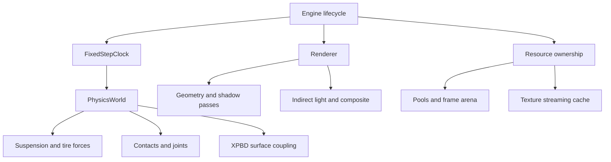
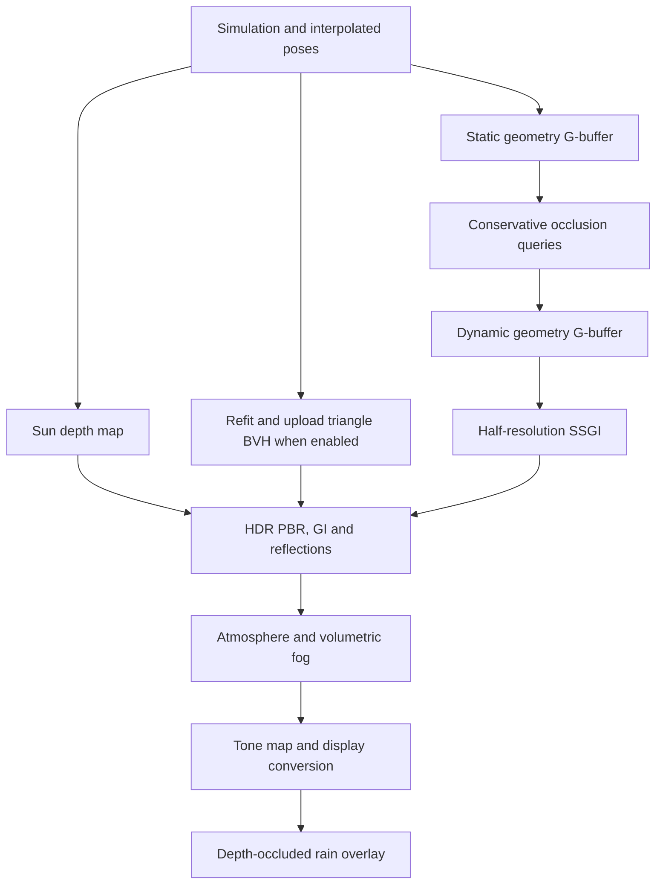

> Historical Phase 1 foundation. For the current city implementation and scope, see `PHASE2_ARCHITECTURE.md` and `VALIDATION.md`.

# Aurora: Phase 1 technical architecture and mathematical foundation

**Deliverable:** an executable, object-oriented reference engine and a controlled laboratory scene. **Scope:** core rendering, physics, spatial acceleration, resource handling, and integration. **Status:** experimental implementation with numerical and native graphics validation; no production certification or AAA-equivalence claim.

All source described here is supplied in the archive. There are no empty subsystem classes, pseudocode implementations, omitted shader bodies, or externally hosted runtime dependencies. Numerical approximations and unsupported cases are identified rather than described as completed features.

## 1. Concrete implementation contract

| Requested subsystem | Executable implementation | Deliberate boundary |
| --- | --- | --- |
| Modern browser renderer | Custom WebGL 2 / GLSL ES 3.00 deferred renderer | No WebGPU backend |
| Physically based materials | Linear metallic/roughness Cook–Torrance BRDF; GGX, Smith, Schlick | Analytic directional light; approximate environment specular; no measured BRDF library |
| Dynamic volumetric fog | Twelve camera-ray integration segments, height density, sun visibility, Henyey–Greenstein phase | Single scattering; no froxel grid or multiple scattering |
| SSGI | Four hemisphere samples, twelve projected march samples each, half-resolution output, bilateral upsampling | Single screen-visible bounce; missing off-screen illumination; no temporal reconstruction |
| Day/night | Continuous solar direction, intensity, temperature-inspired tint; atmospheric sky | Configurable artistic 24-hour cycle rather than astronomical geolocation |
| Shadows | Depth map with PCF; optional actual triangle-BVH ray visibility in GLSL | Software rays, hard sun visibility; not hardware RT and not a ray-traced shadow-map atlas |
| Atmosphere | Spherical exponential-density Rayleigh/Mie single-scattering integral | Eight view steps × four sunlight steps; no precomputed multiscattering LUT |
| Rain / wetness | World-space water field, wet albedo/roughness changes, screen-space reflections, depth-occluded rain lines | No fluid solver, puddle displacement, or full weather ecosystem |
| Spatial partitioning | Binned surface-area-heuristic BVH; CPU broad phase, mesh rays, GPU triangle traversal | BVH selected instead of also maintaining an octree |
| Rigid-body dynamics | Sphere/OBB bodies, inertia tensors, gyroscopic term, SAT, impulses, friction and restitution | No arbitrary convex hulls, continuous collision detection, sleeping/islands, or mesh rigid-body narrow phase |
| Vehicle handling core | Four suspension rays, wheel angular velocity, load-sensitive friction circle, torque curve, gears, braking, aero | Engineering approximation rather than a calibrated tire/engine model |
| Deformable mesh collision | XPBD stretch/shear/bending-distance constraints; particle collision with spheres, boxes, floor; refittable triangle rays | Thin surface; translational rigid coupling; no volumetric FEM, tearing, self collision, or angular contact coupling |
| Ragdoll | Eleven rigid parts, ten ball/socket constraints, swing/twist limits | Not a skinned character/animation system; cone joints rather than anatomical one-axis elbow/knee hinges |
| LOD | Projected geometric-error selection and hysteresis, supplied sphere mesh levels | Error values are author-provided; no automatic mesh simplifier |
| Dynamic occlusion culling | Nonblocking conservative GPU AABB queries, invalidation epochs | Only static geometry is a trusted occluder; dynamic objects remain visible |
| Texture streaming | Async prioritized queue, concurrent decode/load, byte reservations, leases, cancellation, LRU eviction, distance-selected image tiers | Separate authored resolution files; no virtual texturing or sparse GPU residency |
| Memory pools | Generation-checked pooled launch objects; typed-array frame scratch arena | The whole JavaScript heap is not allocation free |

Production readiness cannot be established by writing subsystem code alone. A shipped engine also needs representative content, target-device profiling, platform conformance, robust content tools, recovery testing, long-running stress tests, security review of asset ingestion, and quality/performance acceptance criteria. Those are not asserted here.

## 2. Coordinates, units, precision, ownership

Use a right-handed coordinate system: **+Y up, −Z vehicle forward, +X vehicle right**. Length is in meters, time in seconds, mass in kilograms, force in newtons, torque in newton-meters, angles in radians except the UI clock, and engine speed in revolutions per minute.

JavaScript simulation scalars use the language's double-precision numbers. GPU positions and matrices use 32-bit floats. This is appropriate for the bounded lab, not an Earth-sized world coordinate system. Floating origins and chunk coordinates belong to Phase 2.

Matrices use column-major storage and column-vector multiplication:

$$p_{clip}=PVMp_{local}.$$

The transform is $M=T R S$. Normals use the inverse-transpose of the upper-left $3\times3$ block so nonuniformly scaled boxes and wheels shade correctly. Quaternions are normalized after angular integration. `Vec3.add`, `sub`, `scale`, `cross`, and `normalize` mutate their receiver; static operations create a result. Code that needs a persistent value clones it explicitly.

`Engine` owns the simulation, laboratory input bindings, renderer, and pooled test objects. `Renderer` owns its programs, GPU meshes, targets, shadow texture, query objects, and texture streamer. `GPUMesh` owns its vertex array, vertex buffers, and index buffer. `TextureStreamer` closes decoded bitmaps and deletes cache-evicted textures. Disposal flows from owner to owned resource.

## 3. Fixed-step runtime and interpolation

The physics frequency is **120 Hz**, $h=1/120$ seconds. A visual frame contributes elapsed time to an accumulator $a$. Simulate while $a\ge h$, then subtract $h$ for each step. Render interpolation uses $\alpha=a/h$.

For each body:

$$x_{render}=(1-\alpha)x_{previous}+\alpha x_{current},$$
$$q_{render}=\operatorname{slerp}(q_{previous},q_{current},\alpha).$$

The engine accepts at most 0.1 seconds of elapsed time per frame and at most twelve substeps. It accounts for dropped time explicitly instead of attempting an unbounded catch-up loop. A suspended tab cannot create a large simulation step. The first frame after visibility changes resets the wall-clock timestamp.

At each physics step:

1. Save previous poses and update broad-phase bounds.
2. Apply vehicle suspension, tire and aerodynamic forces.
3. Integrate external force, torque, gyroscopic response and exponential damping.
4. Generate analytic sphere/box/floor and OBB/OBB contacts.
5. Prepare effective masses and apply cached contact impulses.
6. Iterate contact and articulated-joint velocity constraints.
7. Advance position and quaternion orientation; refresh bounds.
8. Solve the deformable surface, update coupled rigid translations/velocities and refit its collider.
9. Refit broad-phase bounds after deformable coupling.

The implementation is single-threaded. The decomposition is suitable for future worker ownership, but no worker scheduling or shared-memory concurrency is claimed.

## 4. WebGL 2 render targets and frame order

The renderer requires `EXT_color_buffer_float`, which makes the selected floating-point HDR targets color-renderable. It checks capability availability, framebuffer completeness and shader compile/link status. A failure is shown through the diagnostic overlay rather than silently selecting an unrelated renderer.

| Attachment | Format | Stored values |
| --- | --- | --- |
| G-buffer albedo | RGBA8 | Linear RGB albedo; metallic in alpha |
| G-buffer normals | RGBA16F | Encoded world normal; perceptual roughness in alpha |
| G-buffer emission | RGBA16F | Linear emissive RGB; wetness in alpha |
| G-buffer depth | DEPTH_COMPONENT24 | Hardware depth |
| Indirect light | RGBA16F at half width/height | One-bounce screen-space estimate |
| Directional shadow | DEPTH_COMPONENT24, 1536² | Sun-camera depth |
| Wetness map | R8, 128² | Surface saturation |
| GPU BVH and triangles | RGBA32F data textures | World bounds, escape links, triangle vertices |

The display conversion happens once, after HDR lighting and fog. Input albedo textures use `SRGB8_ALPHA8`, letting texture sampling convert them to linear color. Uniform material colors are already linear. No lighting calculation uses gamma-encoded RGB.

The G-buffer consumes approximately **24 bytes per full-resolution pixel**, plus approximately **2 bytes per full-resolution pixel** for half-resolution GI. The shadow depth allocation is approximately 9 MiB if represented as four bytes per texel. Driver padding, command buffers, default framebuffer storage and browser overhead are additional. These are allocation estimates, not measured GPU-residency figures.

The inspector limits internal dimensions to 1280×900 and applies an adjustable scale. Canvas CSS dimensions and the device-pixel ratio determine the actual target size. There is no guarantee of 60 FPS on unspecified hardware.

## 5. Physically based shading

The direct-light equation is

$$L_o=\left(f_d+f_s\right)L_i\max(0,n\cdot l)\,V_{sun}+L_{indirect}+L_{emissive}.$$

Let perceptual roughness be $r$ and microfacet roughness $a=r^2$. Define the halfway vector $h=(v+l)/\|v+l\|$, $N_v=\max(\epsilon,n\cdot v)$ and $N_l=\max(0,n\cdot l)$.

The GGX normal distribution is

$$D(h)=\frac{a^2}{\pi\left[(n\cdot h)^2(a^2-1)+1\right]^2}.$$

The Smith masking/shadowing factor uses

$$G_1(x)=\frac{2(n\cdot x)}{(n\cdot x)+\sqrt{a^2+(1-a^2)(n\cdot x)^2}},\qquad G=G_1(v)G_1(l).$$

Fresnel uses the Schlick approximation:

$$F_0=(1-m)(0.04,0.04,0.04)+m\,c,$$
$$F=F_0+(1-F_0)(1-\max(0,v\cdot h))^5.$$

The material response is

$$f_s=\frac{DFG}{\max(\epsilon,4N_vN_l)},\qquad f_d=(1-F)(1-m)\frac{c}{\pi}.$$

This is a direct-light BRDF implementation. The simple sky/environment term is an approximation; it does not claim the split-sum prefiltered cubemap integration, multiscattering energy compensation, or full reference fidelity of a larger PBR renderer. The shader early-outs when the sun is behind the surface.

After exposure, a fitted filmic rational curve compresses HDR values. The final output uses the piecewise linear-to-sRGB transfer function. The fitted curve is not an ACES color-management pipeline.

## 6. Two actual sun-shadow implementations

### 6.1 Raster depth map

The sun uses an orthographic camera covering a 96×96-meter region centered on the lab. World position is projected by the light view-projection matrix, converted to normalized texture coordinates, and compared against the depth map. Nine neighboring comparisons implement 3×3 percentage-closer filtering.

The bias combines a small normal displacement, a surface/light-angle term, and raster polygon offset. Samples outside the fixed shadow volume return visible. The fixed volume is suitable for the lab; it is not a cascaded open-world shadow system. Moving a future player far away requires retargeting this volume or adding cascades.

### 6.2 Software ray visibility

The optional ray path traces **actual world-space mesh triangles**, including interpolated rigid-body transforms and the deformable surface, through an uploaded BVH. This is software traversal in a fragment shader, not a call to hardware ray-tracing extensions.

For each shaded surface point, cast

$$r(t)=p+\epsilon n+t\,l_{sun},\qquad t\in[0.008,300].$$

A triangle hit makes sun visibility zero; no hit makes it one. The sun is treated as a directional point source, producing hard visibility edges. Volumetric fog still uses the raster map to avoid tracing twelve extra sun rays per display pixel.

Each BVH node uses three RGBA32F texels:

| Texel | RGB | Alpha |
| --- | --- | --- |
| 0 | Minimum world bounds | Escape-node index |
| 1 | Maximum world bounds | Leaf triangle count; zero for internal nodes |
| 2 | First triangle index in red | Remaining channels unused |

Each triangle uses three RGBA32F texels for $a,b,c$. The shader follows preorder nodes without a stack. A missed AABB jumps to `skip`; a hit internal node advances; a leaf tests up to four triangles.

The implementation rejects scenes above **16,384 BVH nodes** rather than silently truncating traversal and producing false lighting. It rebuilds when the shadow-casting object topology changes and otherwise refits bounds. This path is intentionally capacity-bounded and computationally expensive.

“Ray-traced shadow maps” mixes two distinct techniques. This implementation exposes both a raster shadow map and ray-traced sun visibility and labels them separately. It does not claim to have built a ray-traced shadow-map cache, temporal denoiser, soft-shadow sampler, or hardware acceleration structure.

## 7. Screen-space indirect illumination and reflections

Reconstruct world position from sampled depth $d$ using

$$p=\frac{(PV)^{-1}(2u-1,2v-1,2d-1,1)^T}{w}.$$

At each half-resolution receiver pixel, construct a tangent basis from its world normal. Four stratified cosine-hemisphere directions are rotated by a deterministic per-pixel hash. For each direction, march up to twelve samples through projected screen space. A depth crossing within a finite thickness accepts a candidate hit.

The hit contributes an estimate of outgoing diffuse direct illumination and emissive light, gated by the facing relation between the hit normal and incoming ray. Average the four samples and multiply by the receiver's nonmetallic albedo during composition. With cosine-weighted sampling, the Lambertian cosine and PDF cancel in the basic estimator.

Bilateral upsampling combines neighboring GI pixels with

$$w=\exp(-3\|p-p_s\|)\max(0,n\cdot n_s)^8.$$

Screen-space reflections reuse the projected marcher with up to twenty-four samples in the reflected view direction. Hits sample the same approximate lit-surface function; misses use the simple sky approximation. Edge fading reduces abrupt screen-boundary transitions.

Both methods are approximations of visible image data. Hidden or off-screen geometry cannot contribute. The GI estimate does not accumulate multiple bounces, and the reflective hit shader is not a recursive mirror renderer. There is no temporal filter, motion-vector buffer, denoiser, or history rejection to claim. Grain and thin-geometry misses are possible.

## 8. Atmosphere, volumetric fog and day/night

The atmosphere uses a spherical Earth radius of 6,360 km and an outer radius of 6,460 km. The local game coordinates are mapped to an altitude above the spherical surface for sky evaluation; this is a lighting model, not a geographic world model.

Rayleigh and Mie densities are

$$\rho_R(h)=e^{-h/8000},\qquad \rho_M(h)=e^{-h/1200}.$$

Optical depths accumulate along the view segment and a secondary sun segment. Transmittance is

$$T=\exp\left[-\beta_R(OD_R^{view}+OD_R^{sun})-\beta_M(OD_M^{view}+OD_M^{sun})\right].$$

The shader uses $\beta_R=(5.8,13.5,33.1)\times10^{-6}\;m^{-1}$ and scalar $\beta_M=21\times10^{-6}\;m^{-1}$. Rayleigh phase is $3(1+\mu^2)/(16\pi)$. Mie uses a Henyey–Greenstein approximation with $g=0.76$ rather than a full measured aerosol distribution.

The horizon accounts for planet intersections. The sky includes an analytic sun disc and a small procedural night-star contribution. Direct-sun intensity and color are art-directed functions of sun elevation, separate from the numerical sky integral.

For fog, use height-dependent extinction

$$\sigma_t(y)=d_f(1+1.5R)e^{-0.055\max(y,0)},$$

where $R\in[0,1]$ is the rain control. Over a segment of length $\Delta s$:

$$T_{segment}=e^{-\sigma_t\Delta s},$$
$$L_{fog}\mathrel{+}=T_{accum}(1-T_{segment})L_{source},\qquad T_{accum}\mathrel{*}=T_{segment}.$$

The source includes ambient scattering and sunlight multiplied by the phase function and raster visibility. Twelve segments cover at most 170 meters. Composition is $L_{final}=T_{accum}L_{surface}+L_{fog}$. This discrete Beer–Lambert form accounts for attenuation and in-scattering together.

For clock hour $H$:

$$\theta=2\pi(H-6)/24,\qquad l=\operatorname{normalize}(0.8\cos\theta,\sin\theta,0.6\cos\theta).$$

No streetlight schedules, NPC routines or weather-state transitions are introduced here; those are Phase 2 systems.

## 9. Rain and material wetness

`WetnessField` is a 128² finite grid covering a square of half-extent 45 meters. Every cell evolves under rainfall, evaporation and diffusion:

$$w_i^{new}=\operatorname{clamp}\left(w_i+\Delta t\,[0.22R\,p_i-E]+a\sum_{j\in N(i)}(w_j-w_i),0,1\right),$$

where $p_i$ is a bounded spatial permeability variation and $a\le0.24$ keeps the explicit four-neighbor diffusion update within its stable coefficient range. Edges use clamped neighbor sampling. The map is a material saturation model, not a conserved fluid-depth simulation.

The geometry shader samples the water field in world XZ coordinates and attenuates wetness on surfaces that do not face upward. Wetness darkens diffuse albedo and reduces roughness. The reflective marcher is enabled for sufficiently wet or metallic pixels. The vehicle samples the same field at its position, reducing available tire friction.

Rain lines use deterministic per-particle seeds and time-based falling positions. Fragment depth is compared with the scene depth before alpha blending. This keeps streaks behind foreground objects. Rain is an inspector-controlled input in this phase; an autonomous weather ecosystem is not included.

## 10. BVH construction, refit, rays and contact broad phase

For an axis-aligned box with size $(d_x,d_y,d_z)$:

$$A=2(d_xd_y+d_yd_z+d_zd_x).$$

Build a binary hierarchy by binning primitive centroids into twelve bins on each nondegenerate axis. Evaluate candidate split cost

$$C_{split}=A_L N_L+A_R N_R.$$

Choose the lowest valid cost; when centroids collapse or partitioning fails, use a median fallback. Leaves contain at most four items. The builder is a compact binned-SAH implementation, not a fully optimized industrial BVH builder with rotations and parallel construction.

Refit from leaves toward the root when item bounds move. Rebuild when the set of items changes. Long-running motion can degrade tree quality, so a large production world needs a measured rebuild/rotation policy; this reference does not claim one.

The ray/AABB slab test computes a near/far interval per axis. For a near-zero direction component it tests whether the origin lies inside that slab, avoiding the $0\times\infty$ and boundary-NaN failure mode. Bounds queries and closest-hit rays use stackless escape links.

For triangle edges $e_1=b-a,e_2=c-a$, the Möller–Trumbore test solves

$$o+t d=a+u e_1+v e_2,$$

accepting $u\ge0$, $v\ge0$, $u+v\le1$ and positive bounded $t$. Both CPU and GPU ray tests are double-sided. Closest-hit CPU traversal tightens its maximum distance after each hit.

Broad-phase candidate generation queries each dynamic body's world AABB. Dynamic/dynamic pairs are emitted once using stable IDs; static/static pairs are skipped. Joint-connected body pairs can be disabled. Exact collision generation happens only after broad-phase overlap.

## 11. Rigid-body integration and collision response

Each rigid body owns position $x$, orientation $q$, linear/angular velocity $v,\omega$, force/torque accumulators, inverse mass and a diagonal local inverse inertia tensor.

For a solid box with half-extents $(h_x,h_y,h_z)$:

$$I_x=\frac{m}{3}(h_y^2+h_z^2),\quad I_y=\frac{m}{3}(h_x^2+h_z^2),\quad I_z=\frac{m}{3}(h_x^2+h_y^2).$$

For a solid sphere of radius $r$, $I=2mr^2/5$. Static bodies have inverse mass and inverse inertia equal to zero.

World inertia transforms with orientation:

$$I_w=RI_bR^T,\qquad I_w^{-1}=RI_b^{-1}R^T.$$

The explicit velocity update includes the gyroscopic term:

$$v^{new}=v+h(g+F/m),$$
$$\omega^{new}=\omega+hI_w^{-1}(\tau-\omega\times(I_w\omega)).$$

Damping multiplies velocities by $e^{-dh}$. Position advances using the updated velocity. Quaternion orientation is updated by the world-space axis-angle increment generated by angular velocity, then normalized. Explicit gyroscopic integration has a finite stability range; extreme spinning bodies need a more robust angular integrator.

### Collision shapes

Sphere/sphere contacts use center separation. Sphere/OBB transforms the sphere center to box-local coordinates and clamps to the box. If the center is inside, it selects the nearest face and produces a finite separating direction.

OBB/OBB uses the separating-axis theorem over up to fifteen axes: three face axes from each box and nine nondegenerate pairwise cross products. A nonpositive interval overlap rejects the pair. The smallest overlap chooses the contact normal. For face contacts, clip the incident face polygon against the reference face's four side planes and retain up to four penetrating points. Edge/edge cases use a single support-based approximate contact point; this is a stated fidelity limit.

The floor uses analytic sphere and box-vertex contacts at $y=0$. It is infinite for the lab's physics. Rendered floor extent is finite; reset the test vehicle if it leaves the visible platform.

### Normal impulses

Contact normals point from body A toward B. At contact $p$ define $r_A=p-x_A$ and $r_B=p-x_B$. The relative point velocity is

$$v_{rel}=(v_B+\omega_B\times r_B)-(v_A+\omega_A\times r_A).$$

For direction $n$, inverse effective mass is

$$K_n=m_A^{-1}+m_B^{-1}+n\cdot\left[(I_A^{-1}(r_A\times n))\times r_A+(I_B^{-1}(r_B\times n))\times r_B\right].$$

The solver accumulates

$$\lambda_n^{new}=\max\left(0,\lambda_n+\frac{b-v_{rel}\cdot n}{K_n}\right).$$

Apply only the change in accumulated impulse. Impulse $J$ acts as $-J$ on A and $+J$ on B. Angular velocity changes by $I^{-1}(r\times J)$ with the matching sign.

The target separating velocity $b$ is the larger of a bounded penetration-correction term and a restitution target for sufficiently fast impacts. Restitution uses the smaller material coefficient to avoid amplification. Small resting contacts suppress restitution.

### Friction and persistence

Solve two tangent directions, then project the accumulated tangent vector onto

$$\sqrt{\lambda_{t1}^2+\lambda_{t2}^2}\le\mu\lambda_n.$$

Mixed friction is the geometric mean of the two coefficients. Contact keys combine body IDs and quantized body-local contact coordinates. Compatible previous normals permit damped warm starting. The default solver uses fourteen iterations per fixed step; tests use eighteen for more demanding stack/joint checks.

Quantized keys can change as features slide. There is no full persistent feature-ID manifold or island sleeping system. Contacts are discrete, so very fast bodies and thin geometry can tunnel. These limits matter for a future action game and are not hidden by the small laboratory tests.

## 12. Articulated ragdolls

The supplied eleven-body rig contains pelvis, torso, head, two upper arms, two forearms, two thighs and two shins. Ten joints connect them. Each joint records two body-local anchors and reference orientations.

For anchors $p_A,p_B$, solve the positional error $C=p_B-p_A$ as velocity constraints on three world axes. The target bias is proportional to $C/h$. Angular effective mass uses the same world inverse inertia operations as contact response.

Swing is the angle between the transformed reference axes. If it exceeds a configured cone angle, apply an angular limiting impulse. Twist is extracted from the relative quaternion's projection onto the joint axis; excess signed twist also produces a limiting impulse. This is an articulated rigid-body test rig with bounded constraints, not animation retargeting or biological joint calibration.

Adjacent-part collision pairs are disabled. Removal clears bodies, joints and pair filters. The lab retains at most three ragdolls, removing the oldest before creating a fourth.

## 13. Vehicle force model

The test chassis is a dynamic box with four independent raycast wheels. Each wheel owns its local anchor, radius, suspension rest length/travel, spring/damper constants, angular velocity, moment of inertia, steering/driven flags, compression and contact load.

For body-up direction $u$, raycast from each transformed wheel anchor along $-u$. If contact is found:

$$\ell=\operatorname{clamp}(t-r_w,\ell_0-travel,\ell_0+travel),\quad c=\ell_0-\ell,$$
$$F_z=\operatorname{clamp}\left(kc+d[-v_{rel}\cdot u],0,F_{z,max}\right).$$

Apply the resulting suspension and tire forces at the contact patch. Torques arise from the real lever arm, so pitching/rolling chassis motion changes suspension loads. This supplies dynamic mass transfer through rigid-body response rather than imposing a purely visual roll animation.

Transform relative patch velocity into wheel forward/right components $v_x,v_y$. Approximate longitudinal slip and lateral slip angle with low-speed regularization:

$$\kappa=\frac{r_w\omega_w-v_x}{\max(2,|v_x|)},\qquad \alpha=\operatorname{atan2}(v_y,\max(2,|v_x|)).$$

The tire forces are

$$F_x=\mu F_z\tanh(7\kappa),\qquad F_y=-\mu F_z\tanh(5\alpha).$$

Project $(F_x,F_y)$ onto the friction circle $F_x^2+F_y^2\le(\mu F_z)^2$. Rain interpolates friction from 1.08 dry to 0.53 saturated. The rear handbrake reduces rear lateral grip and adds braking torque. These coefficients are plausible tuning choices, not fitted data from a specific vehicle.

Wheel angular response is

$$\omega_w^{new}=\omega_w+\frac{h}{I_w}(T_{drive}-F_xr_w-T_{rolling}).$$

Brake torque reduces angular speed toward zero without crossing through zero due to the brake alone. A piecewise-linear torque curve supplies engine torque. Gearing applies current ratio, final drive, efficiency and driven-wheel split. Automatic shifting uses RPM thresholds and a short torque-interruption timer. Reverse selection occurs only near a stop.

Aerodynamic forces use

$$F_{drag}=-\frac12\rho C_d A\|v\|v,\qquad F_{down}=-\frac12\rho C_l A v_{forward}^2u.$$

Applied off-center tire forces, suspension and aerodynamic downforce all feed the same rigid-body integrator. Missing production features include a clutch model, differential, tire relaxation length, calibrated combined-slip curves, camber/toe, anti-roll bars, tire heat/wear, damage and continuous wheel contact.

This is Phase 1's handling foundation. Third-person entry/exit, vehicle ownership, camera rig and gameplay controllers remain outside this phase.

## 14. Deformable surface and XPBD

The mesh is a particle grid with triangle topology. Structural edges, diagonal shear edges and longer bending-distance edges constrain relative motion. Four corners can be pinned through zero inverse particle mass.

For distance constraint $C(x)=\|x_i-x_j\|-\ell_0$, compliance $\alpha$ and step $h$, define $\tilde\alpha=\alpha/h^2$. Solve

$$\Delta\lambda=\frac{-C-\tilde\alpha\lambda}{w_i+w_j+\tilde\alpha},$$
$$x_i\mathrel{+}=w_i\Delta\lambda\,n,\qquad x_j\mathrel{-}=w_j\Delta\lambda\,n.$$

Multipliers reset per physics step and accumulate across the surface's ten iterations. Integrate gravity and damping first, solve constraints, then recover velocities from corrected positions. Area-weighted normals are regenerated and uploaded for shading.

Particle/sphere and particle/OBB contacts use a small surface skin. Penetration correction is split according to particle and rigid inverse mass. Rigid translation changes are converted back into linear velocity changes. Angular inertia is not included in this reduced coupling. Floor constraints keep particles above a small positive height.

The triangle collider shares the updated positions and refits its BVH for exact deformed-surface ray queries. This is distinct from claiming a complete arbitrary triangle/rigid contact solver: rigid coupling here is through particles, and coarse particle spacing can miss small contact features. The dent method applies a local bounded displacement, then refits collision data; it is elastic deformation, not a plastic crash-damage system.

## 15. LOD, frustum and conservative occlusion

For geometric object-space error $e$, camera distance $z$, vertical field of view $f$ and viewport height $H$, approximate projected error by

$$e_{pixels}\approx\frac{eH}{2z\tan(f/2)}.$$

Choose coarser geometry only when its projected error falls below the threshold with a hysteresis margin. Refine when it exceeds the upper threshold. This avoids a single switching boundary causing repeated LOD changes. The input mesh errors are supplied with the mesh levels.

Frustum planes come from row-four ± row-one/two/three combinations of the view-projection matrix. Test the AABB's positive support vertex against each plane. Reject only when the entire bound is outside.

Occlusion uses `ANY_SAMPLES_PASSED_CONSERVATIVE` with an expanded AABB, color writes off and depth writes off. Results are read only after `QUERY_RESULT_AVAILABLE`; the renderer never blocks for a result. Unknown or stale results mean visible.

Render static geometry first, issue queries against static depth, then render dynamic objects. A changing vehicle cannot falsely become a trusted occluder. Camera and static-transform signatures maintain an epoch. A late query result from another epoch is discarded. New objects, moved cameras, changed static transforms, a camera inside a bound and overdue pending queries all fail open to visibility.

This design favors correctness over aggressive culling. It does not claim hierarchical-Z culling, indirect draws, meshlet culling, or occlusion of moving objects. Auxiliary query/shadow draws are not all included in the inspector's displayed geometry draw count.

## 16. Texture streaming and resource budgets

`BudgetedCache` separates queued, loading, resident, failed, cancelled and evicted resources. Each request provides a known byte reservation, priority, loader, optional pin and a promise. The loader receives an abort signal. Concurrency limits bound active loads. Capacity accounting distinguishes resident bytes and in-flight reserved bytes.

Before admitting a load, evict unpinned resident resources in least-recently-used order until the reservation fits. If pins consume available capacity, requests wait until a lease is released. A request larger than the entire budget throws immediately. Callers must release pins; the cache does not automatically revoke a client's ownership lease.

Completion atomically converts reservation into resident allocation before resolving the promise. Failed loads release reservations. Cancellation removes the entry, aborts work and rejects queued/pending requests. A loader completing after cancellation has its returned resource disposed rather than installed under a stale key.

The texture loader fetches a local image, checks its exact expected dimensions, decodes to `ImageBitmap`, uploads an sRGB texture, generates mip levels and closes the bitmap. The budget reserves approximately $4WH(4/3)$ bytes for square RGBA8 images and their mip chain. This excludes decoder staging, browser caches, driver padding, G-buffer and mesh allocations.

The laboratory starts with a pinned 32² fallback. Visible material distance requests 128² or 512² files as needed; ready lower-resolution data remains usable during loading. Resident high tiers can be unpinned cache entries. The included assets are authored resolution tiers, not partial HTTP reads of a single GPU texture.

The generic cache supports arbitrary priorities and eviction. The small lab will not put significant pressure on its 32 MiB texture budget. No unmeasured claim of massive-world texture streaming is made.

## 17. Pooling, frame allocation and lifetime safety

The object pool preallocates twenty-four reusable test-projectile slots. Handles contain an index and a monotonically increasing generation. Acquisition marks a slot live; release resets its contents, increments the generation and returns it to the free list. Access through an old generation or a double release throws, preventing an expired handle from aliasing a newly acquired slot.

The pool removes physics bodies and render entries before returning a slot. This pools lifecycle records rather than asserting that every sphere mesh/body allocation is eliminated. Shared GPU meshes are reused independently.

`FrameArena` owns a fixed `ArrayBuffer`, aligns each typed allocation to its element size, throws on overflow and resets the offset once per visual frame. The renderer uses it for distance and ordered-index scratch arrays. Views are valid only until the next frame reset; JavaScript cannot automatically prevent a caller from retaining such a view.

Context loss pauses rendering. Context restoration recreates GPU resources. The current implementation restores default renderer settings and reloads texture tiers; it does not serialize all GPU resource state. `Engine.dispose()` removes input/context listeners, stops animation, removes vehicle and ragdoll bindings and disposes the renderer.

## 18. Verification, limits and the Phase 1 stopping point

The archive contains the executed validation report and the exact test source. Unit tests exercise numerical outcomes, collisions, constraint error, energy/momentum behavior, spatial-query equivalence, streaming cancellation/accounting, LOD and stale-query invalidation. Native graphics validation compiles all six programs, checks all three framebuffer configurations and renders both shadow modes through real GLSL ES execution.

The available cloud browser returned no WebGL 2 context. Therefore interactive rendering, input behavior, browser-specific resource rules and real-device performance are **not verified in that browser**. Native OpenGL ES validation is useful evidence, but does not replace browser testing. The inspector deliberately shows a capability diagnostic in that environment.

The next independent phase is world layout, seamless spatial chunk streaming, weather states, destructible props and environmental scheduling. It has not been started. Traffic, pedestrian AI, combat, player movement, wanted levels and Phase 4 vehicle/gameplay controllers have not been added. Proceed only after the user's Phase 2 confirmation.

## Primary technical references

These references support the rendering/physics techniques and API contracts; the specific architecture, tuning values and integration choices above belong to this implementation.

1. [Khronos WebGL 2 specification](https://registry.khronos.org/webgl/specs/2.0/) — render-target, GLSL, query and lifecycle API contracts.
2. [Khronos EXT_color_buffer_float specification](https://registry.khronos.org/webgl/extensions/EXT_color_buffer_float/) — color-renderable floating-point formats.
3. [Google Filament material model](https://google.github.io/filament/main/filament.html) — microfacet shading reference. This project uses a smaller model and does not claim Filament equivalence.
4. [Macklin, Müller and Chentanez: XPBD](https://matthias-research.github.io/pages/publications/XPBD.pdf) — compliance-based position constraints.
5. [Erin Catto: Sequential Impulses, GDC 2006](https://box2d.org/files/ErinCatto_SequentialImpulses_GDC2006.pdf) — accumulated impulses, contact iteration and warm starting.
6. [Physically Based Rendering, fourth edition: BVHs](https://www.pbr-book.org/4ed/Primitives_and_Intersection_Acceleration/Bounding_Volume_Hierarchies) — acceleration-structure concepts and surface-area heuristics.

No runtime engine code from these projects is vendored. The source archive contains this implementation in full.
