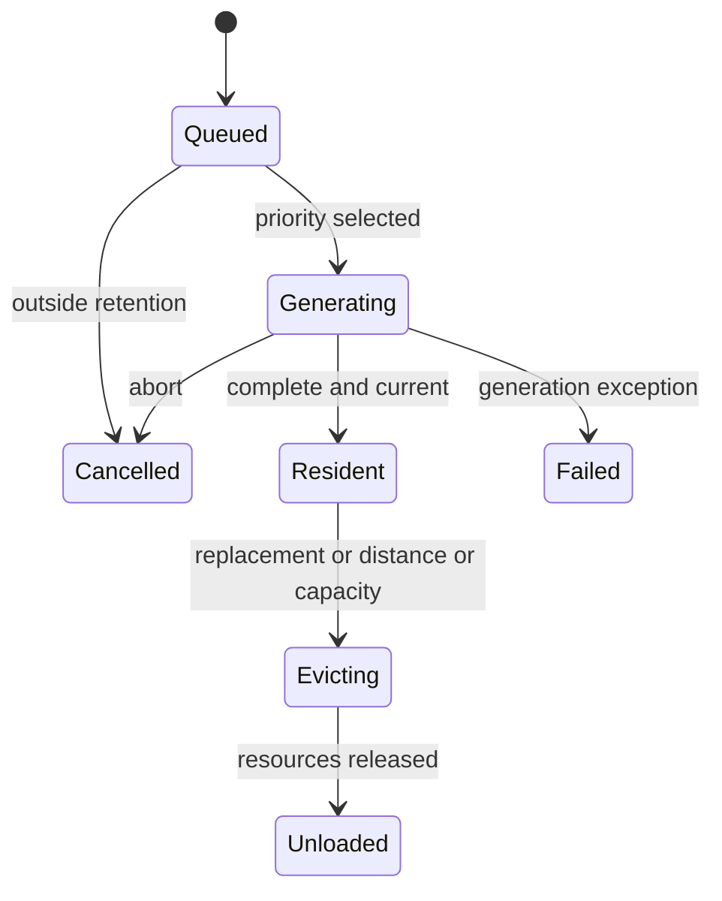
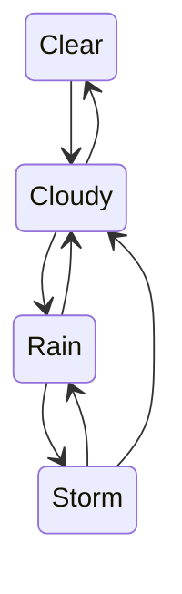
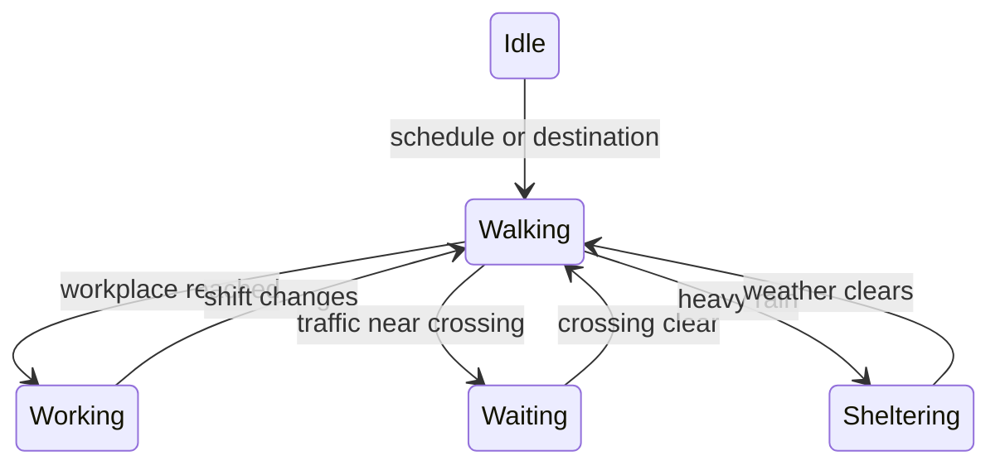
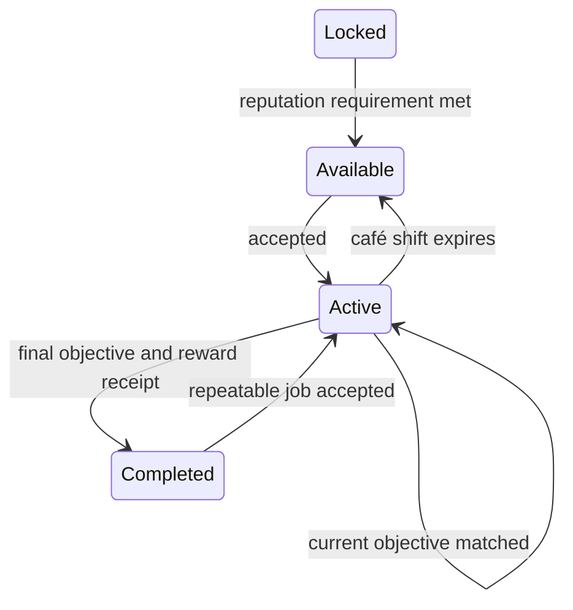

# Aurora Phase 2 — Port Meridian architecture

This document describes the delivered implementation. Every named module below is included in the ZIP and reproduced in `FULL_SOURCE.md`. The earlier `PHASE1_ARCHITECTURE.md` remains the derivation for rigid bodies, suspension, BVHs, PBR, screen-space effects, pools, and resource caches. The current validation record is `VALIDATION.md`.

Port Meridian is a bounded, single-player, procedural city. Phase 2 supplies environment streaming and weather and, in response to the expanded brief, also adds a working subset of city life, player movement, traffic, dialogue, jobs, and missions. It does not claim to finish all of the original Phase 3/4 brief or achieve AAA photorealism.

## Runtime ownership and execution

| Owner | Responsibility | Implementation |
| --- | --- | --- |
| `CityGame` | Browser lifecycle, input, render selection, photos | `src/city-main.js` |
| `CitySimulation` | Deterministic world model, fixed physics, events, saves | `src/game/city-simulation.js` |
| `CityGenerator` | Seeded chunk descriptors and incremental meshes | `src/world/city.js` |
| `ChunkStreamer` | Queue, cancellation, residency, replacement, eviction | `src/world/streaming.js` |
| `GeometryBuilder` / `InstanceBatch` | Merged static meshes / moving instance buffers | `src/world/geometry.js` |
| `SidewalkGraph` / `CubicBezier` | A* walking routes / arc-length road sampling | `src/world/navigation.js` |
| `WeatherSystem` / `MovingWetnessField` | Weather transitions and local surface water | `src/world/weather.js` |
| `DestructionSystem` / `GlassFracture` | Persistent damage and bounded temporary debris | `src/world/destruction.js` |
| `CitizenSystem` | Schedules, route following, conversation and panic | `src/game/citizens.js` |
| `TrafficSystem` / `RoadLoop` | Lane loops, spacing, signals, yielding | `src/game/traffic.js` |
| `CityPlayer` / `FollowCamera` | On-foot collision, car occupancy, camera | `src/game/player.js` |
| `MissionSystem` / `DialogueSystem` | Ordered objectives, topic replies, rewards | `src/game/missions.js`, `dialogue.js` |
| `ProgressStore` | Schema validation, persistence, reward receipts | `src/game/progress.js` |
| `CityUI` / `MapRenderer` | HUD, map, journal, menus, fallback presentation | `src/game/city-ui.js`, `map-renderer.js` |
| `Renderer` | WebGL 2 passes and GPU object lifetime | `src/renderer.js`, `mesh.js`, `shaders.js` |

A visual frame performs chunk planning and a nominal 4 ms generation slice. When playing, it advances weather/time, accumulates fixed physics steps, updates people and traffic, advances mission actions, updates the camera and route, and autosaves when due. It then rebuilds the compact moving-instance arrays, renders the scene, and updates the UI at approximately 12.5 Hz. Menus pause the simulation while streaming and rendering can continue.

Physics runs at 120 Hz with at most 12 steps per frame. Frame time is capped at 0.1 s. The cap prevents an unbounded catch-up spiral after stalls; this deliberately does not preserve wall-clock simulation time through long freezes. Route replanning for the player is limited to one update per 1.2 s, except when objectives or waypoints change.

The simulation does not depend on DOM or WebGL. Tests instantiate the same `CitySimulation` with in-memory storage. Presentation consumes its state, which also permits a functional 2D map view when the required 3D capabilities are absent.

## World coordinates and districts

The right-handed world uses meters, Y up, and a grid in X/Z. Chunk edge length is 80 m:

$$c_x=\lfloor x/80\rfloor,\qquad c_z=\lfloor z/80\rfloor.$$

Flooring rather than truncation is essential for negative coordinates. Chunk keys are stable strings `cx:cz`; asset/prop IDs append semantic identifiers such as `4:1:lamp:0`. Chunk indices range from −6 to +6, giving a nominal 1,040 m square. The coast occupies the eastern side; resident generation excludes chunks beyond the land edge. Walking is bounded to X ∈ [−468,431], Z ∈ [−468,548]. The ocean is scenery, not a swimming region.

District selection is an ordered rule set, so a rural location east of the industrial threshold remains rural unless it is beyond the coast threshold:

| Rule, in evaluation order | District | Generated character |
| --- | --- | --- |
| X > 420 | Meridian Waterfront | Promenade, seawall, piers, sea and boats |
| Z > 230 | Cedar Hills | Heightfield, sparse houses, trees, lookout |
| X > 180 | East Harbor | Sheds, loading doors, crates and workshop |
| X < −150 | Westhaven | Smaller homes and gabled roofs |
| Z < −190 | Northline | Industrial-height lots and extra lane markings |
| Remaining land | Old Meridian | Towers, window grids, storefronts, square |

Northline is a road corridor built from the same connected grid; it is not a modeled grade-separated freeway interchange. Rural roads remain on the grid with raised terrain between them. Named places are reserved before other building lots, and their interaction points stay outside building colliders. The square, garden, and lookout use reserved public-space chunks.

Chunk randomness is derived from integer coordinate hashing plus a subsystem salt. Local generators use their own seeded random streams. A chunk therefore regenerates with the same buildings, colors, prop IDs, and lights, independent of travel order. Saved damage and repairs are applied to these stable IDs instead of serializing whole meshes.

The rural heightfield is shared by rendering samples, ground queries, walking, and suspension raycasts:

$$H(x,z)=\bigl(2.2+2.1\sin(0.018x)\cos(0.021z)\bigr)\,F(z)\,R(x,z),$$

where $F=\operatorname{clamp}((z-230)/100,0,1)$ and $R$ fades from zero within 12 m of a grid road to one 25 m away. At X > 436 the sea floor is −3.5 m. Coarse terrain render tessellation approximates the analytic physical heightfield; it is not a triangle-identical collision surface at every interior point.

## Chunk records and state transitions

A descriptor contains `id`, integer coordinates, world origin, district, building records, props, lights, and named-place references. Generation adds the main mesh, ground mesh, shadow proxy, collider array, and detail level. Residency adds a generation number and references to installed render objects and physics bodies.

A pending job owns an `AbortController`, generator iterator, state, desired level, and priority. Persistent gameplay state lives outside chunk records, so unloading a block never discards a completed repair or mission.

This diagram represents one generation of a chunk. Returning later creates a new queued job. `CHUNK_TRANSITIONS` checks each legal transition, and a bounded 64-entry log supports inspection. Failed jobs keep a bounded diagnostic entry; a subsequent update may queue a retry.

The desired set uses Chebyshev distance:

$$d_\infty(c,p)=\max(|c_x-p_x|,|c_z-p_z|).$$

The default desired radius is two chunks, so an interior location requests 25 blocks. Distance ≤1 receives detailed façades, windows, and denser foliage meshes; the outer ring receives coarse buildings and foliage. A detailed resident is retained rather than immediately downgraded, avoiding visual chatter. Outside radius three, queued/generating jobs are cancelled and resident chunks are evicted. There is also a hard 36-resident capacity, enforced again at commit time.

The queue is sorted by Euclidean distance to the latest player chunk. Generation yields after the road section, each building, and the detail section. The pump checks `performance.now()` between yields and caps iterations at 128. This is cooperative main-thread scheduling: one unusually expensive yield can exceed the nominal 4 ms slice. It is not worker-thread generation or a hard real-time guarantee.

Completed chunks install as a unit. A level upgrade installs its replacement and then removes the previous generation in the same JavaScript turn. Renderer/GPU references, physics bodies, prop lookups, light lookups, and occlusion records are released according to ownership; replacement cleanup does not delete the new generation’s lookup entries. Cancellation closes the old iterator and prevents an incomplete mesh from reaching the scene.

Eviction sorts residents farthest first. Hard-cap eviction favors distance rather than resource-byte accounting. The Phase 1 texture cache still accounts GPU texture reservations separately. The city’s mesh residency policy is a count cap, not a promise of a particular megabyte budget.

A persistent, inset box silhouette for the entire city provides a distant skyline while blocks are absent. Its approximately 5,040 triangles are deliberately cheap. Detailed meshes enclose these inset boxes when resident. Horizon proxies have no gameplay collision; collision appears with resident chunks. Ordinary walking/driving is covered by the preload radius, but an instantaneous shuttle can show a brief refinement period. There is no loading-screen transition.

## Weather, wet surfaces, and scheduled lighting

The weather controller is a seeded state machine. Each state lasts 70–145 simulation seconds after the initial clear interval. Adjacent transitions avoid jumping directly from clear skies to a storm:

Clear can also remain clear. State targets are `(rain, clouds, fogDensity, wind)`:

| State | Rain | Clouds | Fog density | Wind |
| --- | ---: | ---: | ---: | ---: |
| Clear | 0 | 0.12 | 0.003 | 0.15 |
| Cloudy | 0 | 0.75 | 0.005 | 0.35 |
| Rain | 0.55 | 0.90 | 0.008 | 0.55 |
| Storm | 1 | 1 | 0.012 | 1 |

Each channel approaches its target using $q'=q+(q_t-q)(1-e^{-\Delta t/12})$. Storm flashes decay rapidly and briefly raise exposure. Clouds attenuate direct sunlight. The wind channel is state data; it is not a structural wind-force or vegetation simulation.

Wetness uses a 128×128 field covering 400×400 m around the player. Its origin moves in 16-cell increments. On recenter, overlapping cells are copied with an integer offset and newly exposed cells use a regional average. Sampling clamps to the local field boundary; distant surfaces do not have independently retained water histories.

For cell $i$, the update is:

$$w_i'=\operatorname{clamp}\left(w_i+(0.22rp_i-e)\Delta t+a(w_L+w_R+w_U+w_D-4w_i),0,1\right),$$

$$a=\min(0.24,0.1\Delta t),\quad e=0.012\operatorname{lerp}(0.25,1,\text{sun}),\quad p_i=0.6+0.4\sin(0.17i_x)\cos(0.23i_z).$$

Clamping and the diffusion coefficient bound keep the scalar field finite. This is a visual saturation model, not a shallow-water solver: there is no height-driven runoff, roof occlusion, or fluid volume conservation. An R8 texture transfers the field to GLSL; its world-space origin is a uniform, so nearby material wetness follows the same grid as the tire-grip query.

Player tire friction interpolates from 1.08 dry to 0.53 wet before handbrake adjustments. Citizens choose shelter behavior above rain 0.55. Screen-space reflections and material roughness changes provide the surface response. Screen-space effects only know visible geometry; they cannot reconstruct off-screen buildings or replace path tracing.

Solar time advances by 0.55 game minutes per simulation second. Streetlights, car headlights, and selected windows use a smooth night factor:

$$n=\operatorname{clamp}((0.15-s_y)/0.28,0,1),$$

where $s_y$ is solar elevation from the day/night direction. Up to ten nearest working streetlights and two player headlight point lights enter the deferred lighting arrays. Damaged mission lamps stay off until repaired. Window emission is scheduled by material data. These are bounded local point lights and emissive façades; windows do not each spawn a world light, and headlights do not cast independent shadow maps.

## Destruction and persistent damage

Breakable props have stable IDs and immutable type/placement data. Breaking a prop first records its ID, removes its collider, and emits a local panic event. The render assembler omits the unbroken prop after that, including after chunk reload. X breaks a reachable object within 2.7 m. Vehicle contacts can break a prop above an accumulated normal-impulse threshold of 180.

Bins/crates emit five rigid fragments. The square’s 2.6×1.6 m pane uses nine seeded Voronoi cells. Each seed’s polygon starts as the pane rectangle and is clipped against the perpendicular bisector to every other seed. The half-plane for seed $s_i$ against $s_j$ is:

$$p\cdot(s_j-s_i)\leq\frac{\|s_j\|^2-\|s_i\|^2}{2}.$$

Segment intersections use $t=d_a/(d_a-d_b)$, where $d_a,d_b$ are signed distances to the clip plane. Each convex polygon is triangulated around its centroid and attached to a dynamic body. The area-partition test verifies that all polygons sum to the original pane area.

Glass fragments use small box collision proxies and opaque reflective materials; this implementation does not provide transparent refraction, fracture mechanics, or exact polygon collision. Glass debris expires after seven seconds, other debris after ten; a 36-piece cap removes the oldest excess pieces. Destroyed-state IDs persist separately from this transient visual/physics debris. Buildings, seawalls, barriers, and vehicles do not fracture as part of Phase 2.

## Walking graph and routes

Each eligible block has eight sidewalk ring nodes at local coordinates `(10,10)`, `(40,10)`, `(70,10)`, `(70,40)`, `(70,70)`, `(40,70)`, `(10,70)`, `(10,40)`. Ring edges connect neighboring nodes. Reciprocal cross-block edges join corners and midblock crossings. Water-side nodes are omitted. The supplied layout has 1,183 nodes.

A* uses a binary min-heap. The cost of an edge is its X/Z Euclidean length plus four cost units for a crossing. The heuristic is straight-line X/Z distance to the goal:

$$f(v)=g(v)+h(v),\qquad h(v)=\|v-g_{\mathrm{goal}}\|_2.$$

Because crossing penalties are nonnegative and edge lengths are Euclidean, this heuristic does not overestimate remaining graph cost. Improved paths update a predecessor map; reconstruction returns cloned positions. Search is capped at 12,000 expansions and returns an empty route on failure. Nearest-node lookup checks neighboring blocks before falling back to the whole graph.

For nearby player goals under 45 m, a clear world ray allows a direct route. Otherwise the route includes sidewalk nodes and the final interaction point. These routes are guidance and citizen navigation, not a general polygon navmesh: arbitrary last segments can cut corners, and the graph does not dynamically rebuild around debris. Crossing waits and local separation handle nearby traffic and crowds.

## Citizens and dialogue

There are 80 resident records: eight authored contacts and 72 seeded residents. At most 44 within 160 m receive visible articulated models. Off-screen residents still advance on a coarse 0.6 s update cadence. Route planning is limited to four requests per visual tick; each agent caches its current target key.

Records hold ID/name/role, home, workplace, leisure destination, shift hours, position/yaw, route/index, state, gait phase, panic timer, and conversation flag. Generic schedules choose work, evening leisure, or home. Twelve locals take rotating square routes during the day. Named contacts remain around accessible activity points and switch work/idle/shelter animation states; they are not fully simulated employees with inventory or production.

Conversation and panic have higher priority than this daily loop. A conversation freezes movement and turns the speaker toward the player. A disturbance within 28 m sets a seven-second flee timer, chooses a graph destination away from the source, and raises walking speed by 2.9×. Fast cars can trigger shorter local panic. Agents resume schedule selection after the timer. This is a bounded reaction model; it has no injury, police escalation, or persistent emotional simulation.

Visible agents add a separation vector for neighbors inside 1.05 m and the player inside 1 m, then normalize the combined desired motion. This is local steering rather than a collision-proof crowd solver. Rendering uses shared boxes and spheres with joint-style transforms: gait-driven thighs, shins, shoes, arms, a head, hair, and work gestures. It does not use skeletal asset import, inverse kinematics, or motion-capture animation.

Dialogue is a deterministic authored system. Opening a contact records familiarity, emits mission talk events, and selects context-aware choices. Topic matching handles jobs/work, directions, weather, manifests, and harbor stories; unmatched input gets an authored fallback. No text is sent to a language-model API. Optional speech uses the browser’s speech synthesis when enabled. It is off by default.

## Traffic and the drivable vehicle

The traffic layer contains 32 cars on eight rounded rectangular routes, including opposing lanes offset by 3.1 m. Each route contains cubic Bézier turns and straight cubic segments. For control points $A,B,C,D$:

$$P(t)=(1-t)^3A+3(1-t)^2tB+3(1-t)t^2C+t^3D.$$

The analytic derivative supplies the forward direction. A sampled arc-length table approximates $s(t)$; binary search and interpolation invert it to advance a car by $v\Delta t$ rather than by an uneven parameter increment. Curves normally use 32 samples and straight segments four.

A car’s target speed is the minimum of its seeded cruise speed, turn limit, signal stopping speed, headway limit, and player/pedestrian obstacle limit. Stopping targets use a square-root distance relationship equivalent to $v\leq\sqrt{2ad}$. Speed changes are bounded by 2.1 m/s² acceleration and 5 m/s² braking. Forward/side projections test whether another agent lies in the lane corridor.

Signals have a 28-second cycle, with spatially staggered offsets. X is green during seconds [0,11), amber [11,13); Z is green [14,25), amber [25,27). The gaps give all-red clearance. Tests verify that crossing directions never share green. Visible signal fixtures show the X phase. Traffic cars are visible within 220 m.

This is a bounded O(N²+NP) controller, practical for 32 cars and the visible pedestrian set. It does not implement arbitrary destinations, lane changes, overtaking, emergency dispatch, traffic collision rigid bodies, or aggressive/cautious personality trees. Cars can still overlap under unusual cross-route or gridlock configurations. Those limits matter when expanding Phase 3.

The player’s Aster GT is a separate `RaycastVehicle` with a real rigid chassis, four suspension rays, spring/damper loads, friction-limited longitudinal/lateral tire forces, torque curve, shifting, braking, and aerodynamic force from Phase 1. Its wheel transforms follow suspension positions. Entry requires proximity and low speed; exit checks clearance on either side and rejects excessive speed. R recovery zeros chassis and wheel motion and moves the car to a nearby road. Vehicle body damage/deformation is not added here.

## On-foot controller and camera

The kinematic character uses a 0.32 m horizontal half-width and a 1.72 m body-height query. Motion is camera-relative and resolved separately along X and Z against BVH box bounds. It steps over small supports and queries a local support volume while descending. Speeds are 3 m/s walking, 6.2 m/s sprinting, and 1.25 m/s slow walking. Exponential smoothing controls speed and yaw. Jump starts with 4.4 m/s upward speed and gravity is 9.81 m/s².

This is a box-based character model, not a swept capsule controller. C changes speed rather than providing a reduced crouching collider. Climbing, cover, melee, weapons, and ragdoll transitions are not implemented for the city player. Fast-motion tunneling and irregular geometry require a stronger controller before production use.

The third-person camera damps its target and eye with exponential time constants and raycasts the spring arm against the world, excluding the player chassis. Driving increases arm length and FOV with speed. Standard orbit distance is clamped to 3.5–18 m. Photo mode permits up to 120 m, bypasses arm obstruction, and lifts an endpoint that lands inside a building. Its screenshot captures the rendered canvas, not DOM labels or menus.

## Missions, work, and economy

Mission definitions contain stable ID, title, category, reward, reputation, giver, repeatability, and ordered steps. Runtime state contains status, step index, flags, remaining shift time, and route variant. Event kinds include `talk`, `reach`, `interact`, `work`, `repair`, and `photo`. Only an event matching the current step advances a mission. The neighborhood-voices objective collects three distinct contact IDs.

The graph applies per definition. Most stories start Available; arrival starts Active. The missing manifest requires four reputation. One-time completed stories reject reacceptance. The journal can start available missions directly, while conversations provide their narrative context and can satisfy the first talk/collection event.

Café work requires proximity, opening hours, an active shift, and the correct next action. An in-progress action disables the work buttons and freezes player movement; completion emits its work event. The sequence is brew (2.6 s), pack (1.4 s), serve (1.4 s), repeated three times. The 150 s timer pauses during menus and conversations. Timed-out shifts become retryable without payment. Repair actions require the tool-collection step, the exact next lamp, a 2.8 m range, and an uninterrupted 2.2 s E hold.

Courier routes select clinic/market/harbor using the saved cycle modulo three. The chosen variant is saved so a reload cannot silently change a delivery. The shuttle consumes ten game dollars only after destination, stop proximity, on-foot state, and balance checks pass. It advances eight game minutes, streams around the destination, immediately evaluates arrival objectives, and saves. The economy is a game wallet and mission rewards, not wages paid to every resident or a supply/demand simulation.

Reward receipts use stable keys such as `mission:arrival:0` and a cycle index for repeatable work. `ProgressStore.reward()` rejects an already recorded key before adding currency or reputation. Mission completion marks status before saving the reward, preventing ordinary reloads from paying a completed step again. localStorage is editable client-side; this is single-player persistence, not an anti-cheat or transactional server database.

## Rendering changes over Phase 1

Static block geometry is merged into one main and one ground mesh per resident chunk. Per-vertex RGB and four material channels encode roughness, metallic, emission, and wettable weight. Shared box/sphere geometry renders people, cars, lamp fixtures, and props through instance arrays. This avoids a draw call for every moving body part.

Each instance occupies 24 floats / 96 bytes: a 4×4 column-major transform, RGBA color, and four material channels. GLSL attributes use locations 5–8 for the matrix, 9 for color, and 10 for material, with divisor one. `GPUMesh` grows its buffer only when needed, uploads the live range once per instance version, and reuses it for shadow and geometry passes. Attribute/offset/reuse behavior is covered by a mock-GL test; the native graphics test also draws independently transformed red and green instances into the G-buffer.

For an orthogonal TRS matrix with linear columns $a_0,a_1,a_2$, nonuniform-scale normal transformation is computed without a full inverse:

$$n'=\operatorname{normalize}\left(a_0\frac{n_x}{\|a_0\|^2}+a_1\frac{n_y}{\|a_1\|^2}+a_2\frac{n_z}{\|a_2\|^2}\right).$$

The builders use positive, nonzero TRS scales. This shortcut assumes orthogonal columns and must not be used for arbitrary sheared transforms.

The passes are raster sun depth, HDR material G-buffer, optional half-resolution screen-space GI, deferred lighting/fog/reflections to a display target, edge-aware antialiasing, and rain overlay. Seven actual shader programs serve these passes and occlusion queries. Four framebuffer configurations cover depth shadow, material G-buffer, GI, and display color. The antialiasing pass filters luminance edges; it has no temporal history or motion-vector reconstruction.

The city’s 1,536² sun shadow map follows the camera target over a 200 m square, snapping target X/Z to a shadow texel to reduce shimmer. This is a single local raster map with PCF, not cascaded or hardware ray-traced city shadows. Phase 1’s triangle-BVH software-ray mode remains in the laboratory; the city deliberately uses raster mode because dynamic instances and full-city triangle counts are outside that small diagnostic path’s intended scope.

Frustum rejection applies to block and instance-batch bounds. Conservative occlusion queries are retained from Phase 1, invalidated by camera/static-scene changes, and polled without assuming an unfinished result. Large moving instance batches are not individually occlusion culled. Detailed/coarse block levels and persistent skyline geometry provide the main city LOD policy.

On eviction, unique chunk GPU meshes, LOD state, and occlusion queries are deleted. Shared body-part meshes remain owned by the renderer for the scene lifetime. The original budgeted texture streamer and pooled physics utilities remain available; most city materials use procedural vertex data instead of a large streamed texture set.

## Persistence and lifecycle

`ProgressStore` uses the versioned key `aurora.port-meridian.v2`. It records cash/reputation, clock, mission state and variants, reward receipts, conversation familiarity, broken prop IDs, repaired lamp IDs, job cycles, player/car positions, weather snapshot, and quality/voice settings. Validation bounds numeric values, vectors, array sizes, and mission fields before use.

Weather persistence retains state, remaining interval, rain/cloud interpolation, elapsed time, and RNG position. Fog and wind converge again from defaults after load. The wetness field, debris, NPC routes, traffic phases, wheel speeds, car orientation, and current conversation are transient. Loading a visit therefore restores progression and location rather than a bit-exact physical snapshot of every moving object.

Saves occur every ten simulation seconds, on mission updates, on explicit save, on visibility loss, and during normal disposal. Failures return a boolean and show session-only progress. No silent account synchronization is implied. The storage is browser-origin scoped; switching between `localhost` and `127.0.0.1`, or changing ports, creates a different origin.

Input handlers clear held keys on blur, panel changes, and visibility changes. Context loss pauses rendering; restoration reconstructs renderer-owned GPU state. That restoration code is implemented but not end-to-end verified in a WebGL browser here. Page disposal cancels animation, unregisters listeners, stops speech, saves, cancels pending generation, removes resident bodies/meshes, and releases renderer resources. A new-visit reset bypasses the old simulation’s final save so it cannot overwrite the fresh progress.

## Verified scope and expansion boundaries

The automated suite exercises the shared engine plus city generation/seams, mission-point accessibility, chunk capacity/cancellation, A* connectivity, curve progression, traffic braking/signals, bounded weather, wetness recentering, glass area partition, save validation, isolated reset, all seven mission arcs, reward idempotence, dialogue, citizens, player collision/jumping, terrain raycasts, timed café work, shuttle guards, and integrated progression/cleanup. Current totals and render evidence appear in `VALIDATION.md`.

The browser used for this build could not create WebGL 2. It exercised the actual game interface and model through the explicit map renderer. Native ES renders use the shipped geometry and GLSL, but they do not prove browser WebGL conformance, GPU performance, smooth animation, touch-device usability, or long-session memory stability. There is no hardware FPS claim.

Before scaling this into a larger game, the concrete gaps are continuous character/vehicle collision, general navigation and lane graphs, richer traffic arbitration, indoor content, imported/skinned assets, hierarchical light/shadow budgets, worker generation and measured byte budgets, full save snapshots if required, long-duration profiling, and target-device visual QA. Combat, cover, police/wanted dispatch, emergency vehicles, vehicle deformation, freeform AI conversation, multiplayer, and a global economy are outside this delivered chapter. The existing ragdoll and deformable demonstrations remain in the laboratory and are not presented as city gameplay features.
